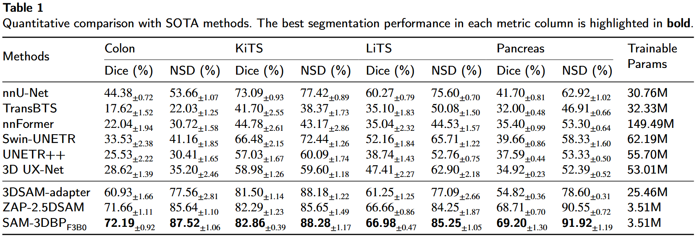
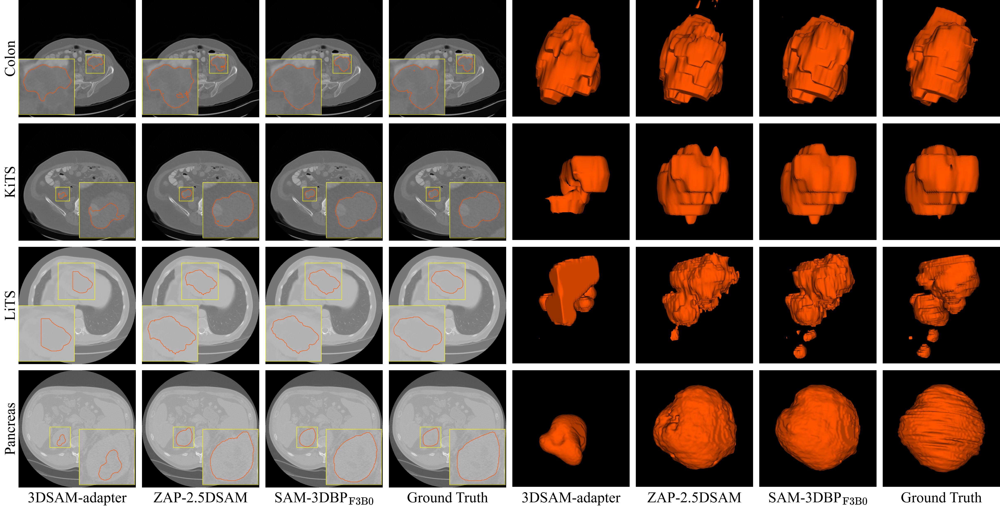

# SAM-3DBP: Parameter-Efficient SAM Adaptation for Tumor Segmentation with 3D Bidirectional Point Prompts
by Cai Guo, Bishenghui Tao, Zexun Zhou, Yuxi Jin, Zhou Liu, Puicheng Peng, Yinghui zhu, [Hong-Ning Dai](https://www.henrylab.net).

Pytorch Implementation for the paper "SAM-3DBP: Parameter-Efficient SAM Adaptation for Tumor Segmentation with 3D Bidirectional Point Prompts"

### Comparision with SOTA methods


### Visualization of The Segmentation Results


## Datasets
We adopted the same data partitioning strategy employed in the [[3DSAM-adapter]](https://github.com/med-air/3DSAM-adapter) presented by Shizhan Gong et al.

## Dependencies
```
conda create -n sam3dbp python=3.12
conda activate sam3dbp
pip install torch==2.8.0 torchvision==0.23.0 torchaudio==2.8.0 --index-url https://download.pytorch.org/whl/cu129
conda install scipy
pip install nibabel
pip install monai==1.5.1
```

## SAM3D-BP
Our implementation is based on a single NVIDIA RTX 3090 GPU, the total runtime GPU memory footprint of the model during the training and inference phases was below 9 GB.

To use the code, first download the pre-trained weight of SAM-B from [[here]](https://dl.fbaipublicfiles.com/segment_anything/sam_vit_b_01ec64.pth) and place it in the folder `ckpts`. Then download the datasets and place them in the folder `datasets`.

Running the following command to train the SAM-3DBP:
```
python train.py
```

Running the following command to test the SAM-3DBP:
```
python test.py
```

## Acknowledgement
Our code is based on [[Segment-Anything]](https://github.com/facebookresearch/segment-anything) , [[3DSAM-adapter]](https://github.com/med-air/3DSAM-adapter) , and [[ZAP-2.5DSAM]](https://github.com/CaiGuoHS/ZAP-2.5DSAM).
